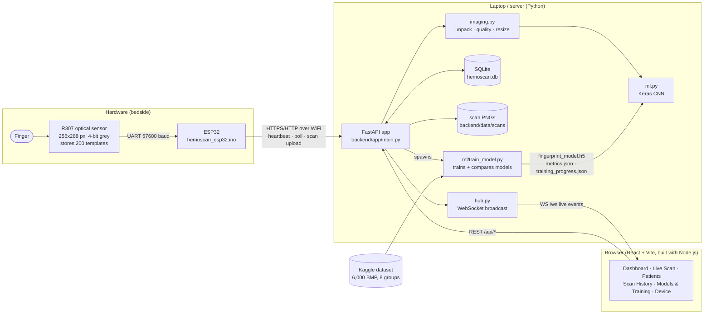

# 1. System overview

**Key design choices**

* The ESP32 only makes *outgoing* requests (it polls for commands every second), so no router or port-forwarding setup is needed.
* All ML runs in Python on the server — the ESP32 has neither the RAM nor the speed for a CNN.
* The same preprocessing function (`imaging.to_model_input`) is used in training and live prediction, so the model sees identical inputs in both.
