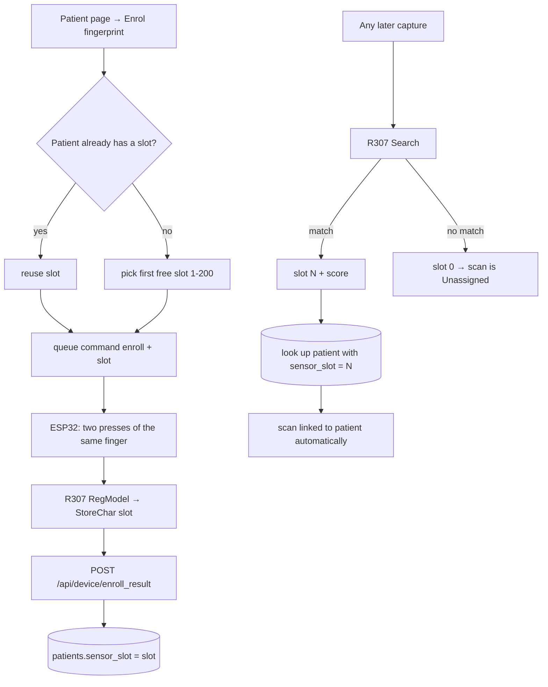

# 4. Enrolment and identification

The R307 does the *identity* matching itself (minutiae templates stored on the sensor);
the CNN only does the *blood-group* estimate. These are two separate jobs.

