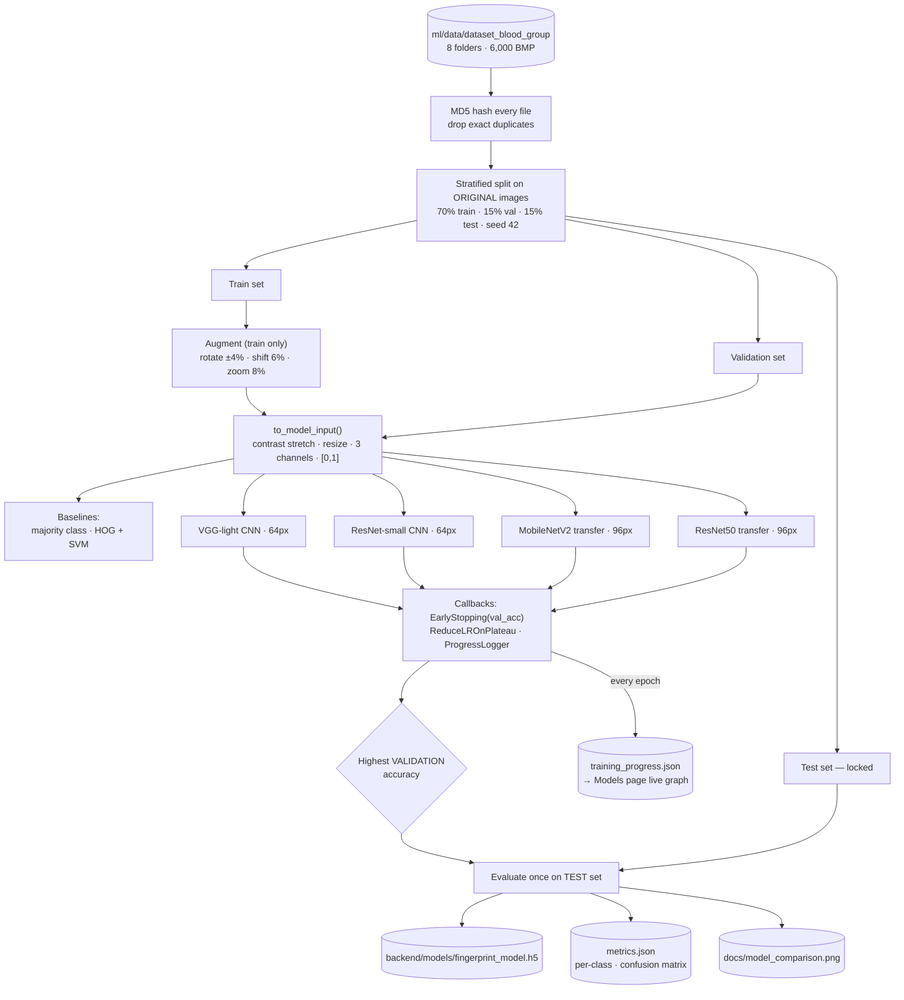

# 5. ML training pipeline (`ml/train_model.py`)

Why the test set is touched only once: choosing a model by test accuracy would make the
test number optimistic. The reference notebook's 88 % has this kind of leak (augmented
copies of the same image ended up in both train and test).
