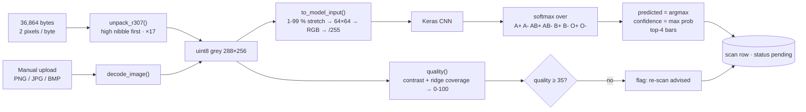

# 6. Inference — sensor bytes to prediction

Modes (`backend/app/ml.py`): **model** = real file loaded · **demo** = random Dirichlet output, clearly labelled · **none** = scan stored without prediction.
