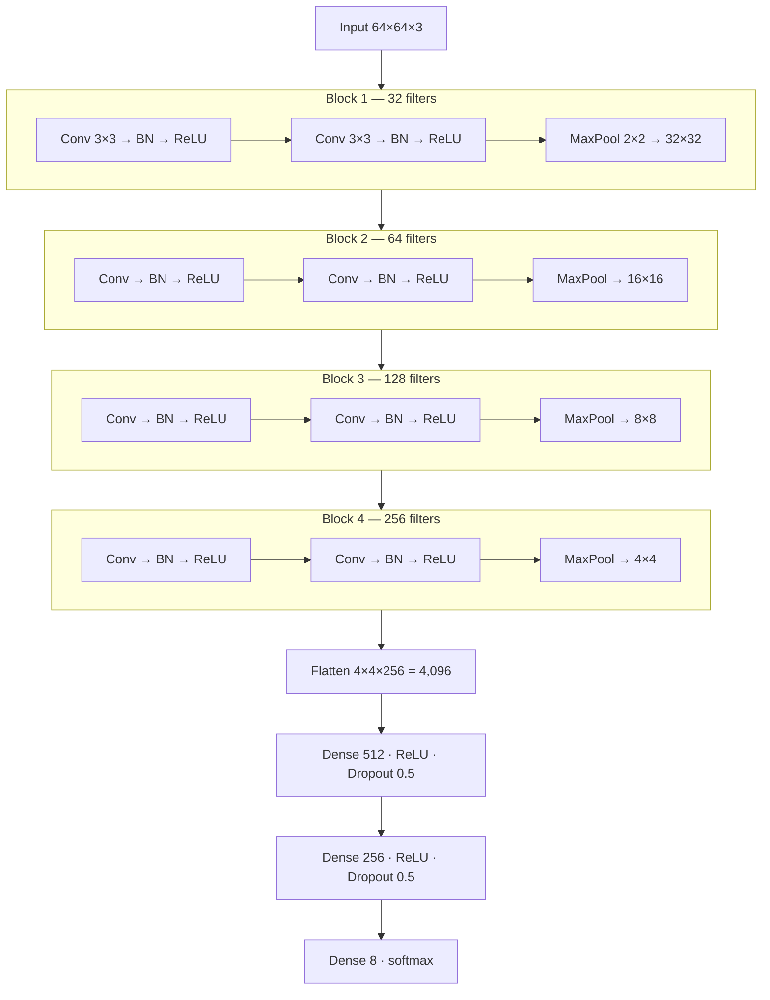

# 7. VGG-light CNN (default model)

What each part learns on a fingerprint: block 1 → ridge edges and orientation; block 2 → ridge
endings and bifurcations (minutiae-like shapes); blocks 3-4 → larger structures such as cores,
deltas and the loop / whorl / arch pattern; dense layers → map those features to the 8 groups.
Optimiser Adam (lr 5e-4), loss categorical cross-entropy, batch 32.
