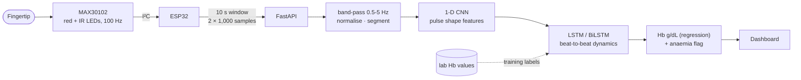
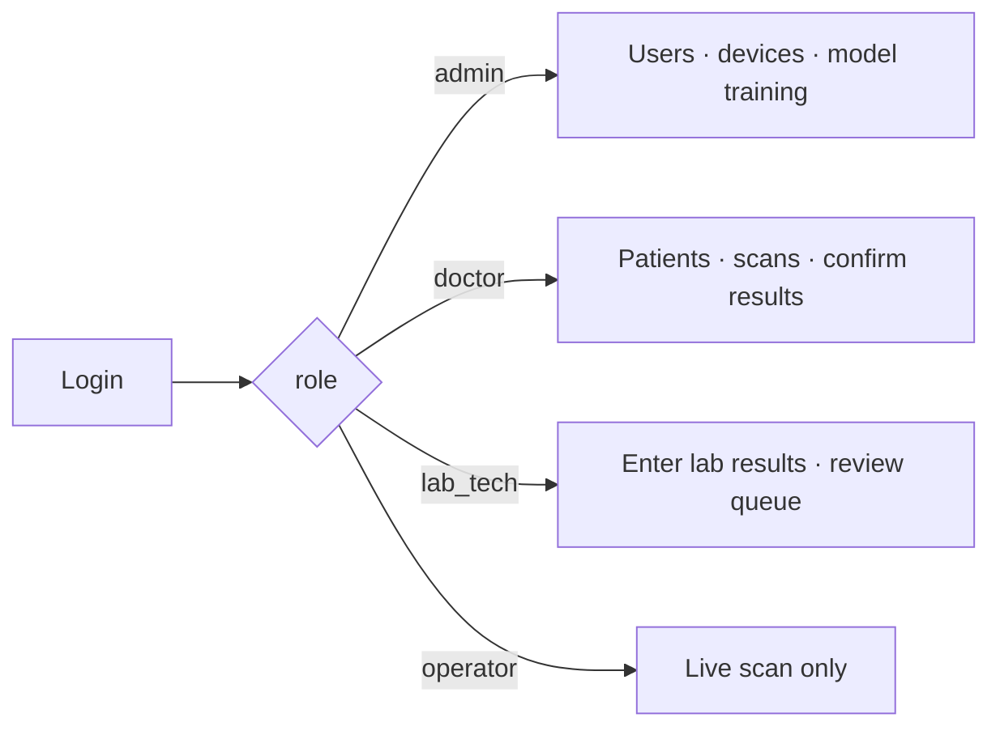

# 10. Proposed extensions (not built yet)

## A. Haemoglobin / SpO₂ estimate with a PPG sensor + CNN-LSTM

A fingerprint *image* holds no information about the blood itself. Measuring something about the
blood (haemoglobin, SpO₂, heart rate) needs light passing *through* the fingertip. That is
photoplethysmography (PPG), from a sensor such as the MAX30102. A PPG signal is a **time series**,
and that is where an LSTM belongs.

## B. Role-based user sections

