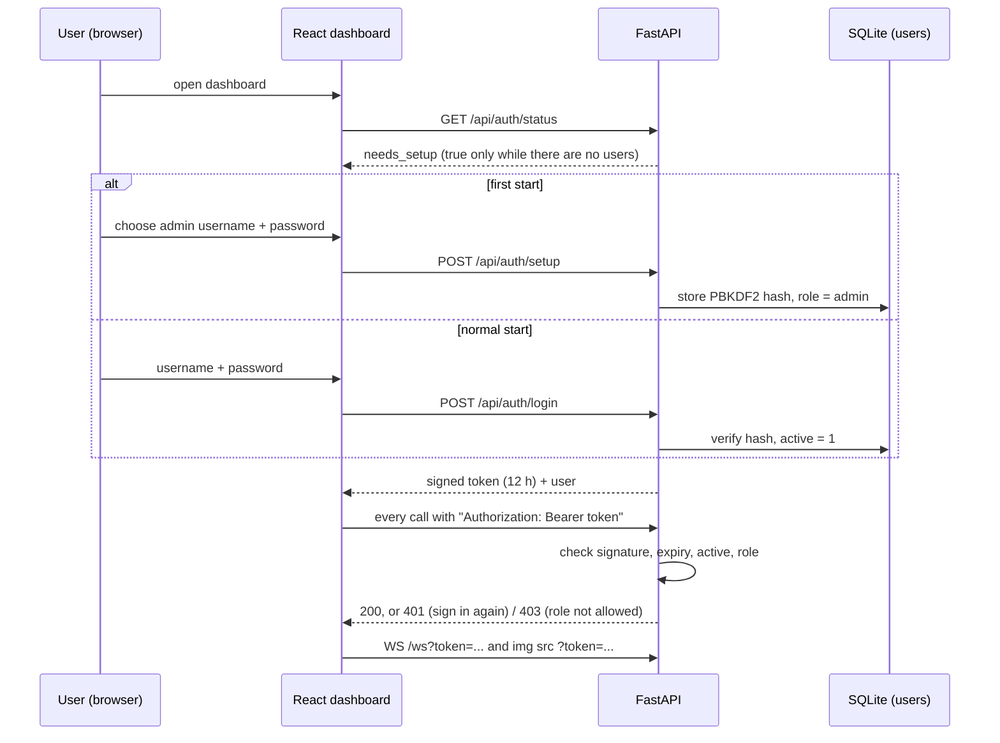
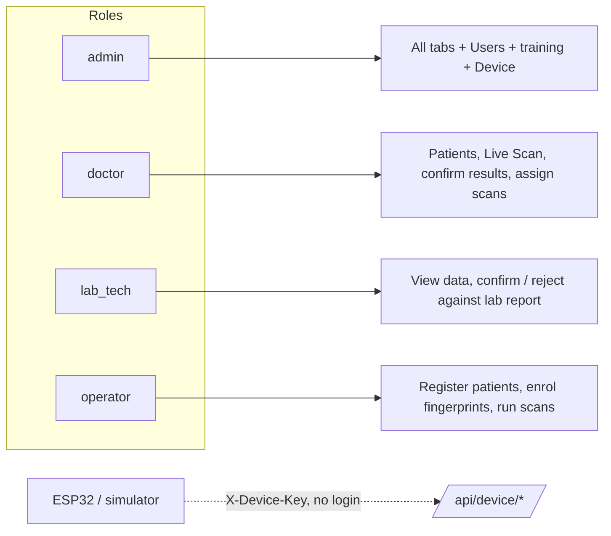

# 11. Login and user roles

| Capability | admin | doctor | lab_tech | operator |
|---|:-:|:-:|:-:|:-:|
| Dashboard, Patients, Scan History, Models (view) | ✔ | ✔ | ✔ | ✔ |
| Live Scan, enrol fingerprint, upload image | ✔ | ✔ | | ✔ |
| Create patient | ✔ | ✔ | | ✔ |
| Edit patient | ✔ | ✔ | | |
| Delete patient / scan | ✔ | | | |
| Confirm / reject against lab result | ✔ | ✔ | ✔ | |
| Assign a scan to a patient | ✔ | ✔ | | |
| Start / stop training | ✔ | | | |
| Device & Model tab, Users tab | ✔ | | | |

The dashboard hides what a role cannot use, but the **API enforces it** (`backend/app/main.py`, `require(...)`).
