# Fingerprint patterns

## The five standard pattern types (Henry / NIST classes)

Synthetic images generated by [`make_patterns.js`](make_patterns.js) (`node make_patterns.js <hemoscan folder>`).
Ridges are grown from noise with Gabor filters that follow an orientation field built from the pattern's
cores and deltas. This is the method used by synthetic-fingerprint generators such as SFinGe.
They contain no real person's fingerprint.

| Arch | Tented arch | Left loop | Right loop | Whorl |
|:-:|:-:|:-:|:-:|:-:|
| 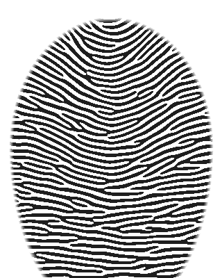 | 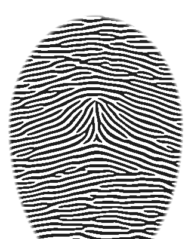 | 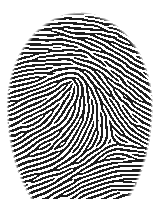 | 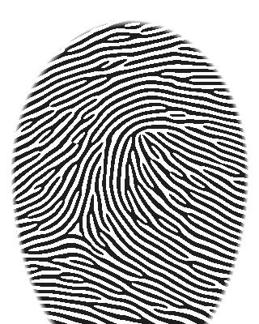 | 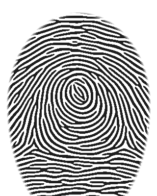 |
| ridges flow from one side to the other with a gentle rise · 0 deltas | sharp central spike · core and delta in line | ridges enter and leave on the **left** · delta on the right | ridges enter and leave on the **right** · delta on the left | circular / spiral ridges · 2 deltas |
| ≈ 5 % of fingers | ≈ 3 % | loops together ≈ 60-65 % | | ≈ 30-35 % |

(Frequencies are typical population figures; they vary between populations and studies.)

## Features inside a fingerprint

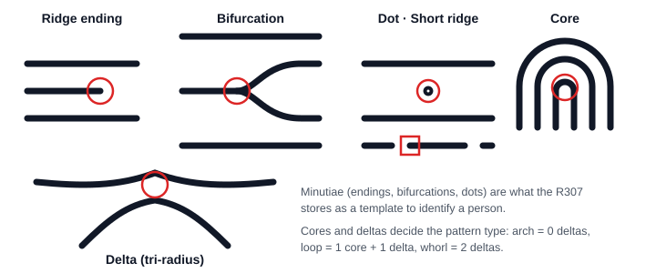

## Real samples from the training dataset (one folder per blood group)

Converted from `ml/data/dataset_blood_group/<group>/*.BMP` (first, middle and last file of each folder, 2× enlarged).

| A+ | A− | AB+ | AB− | B+ | B− | O+ | O− |
|:-:|:-:|:-:|:-:|:-:|:-:|:-:|:-:|
| 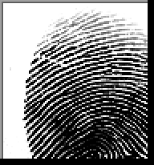 | 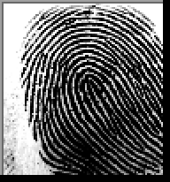 | 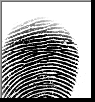 | 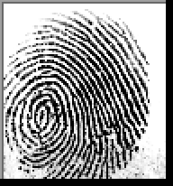 | 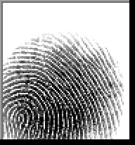 | 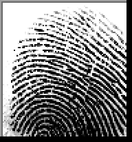 | 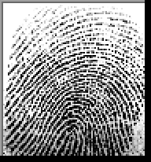 | 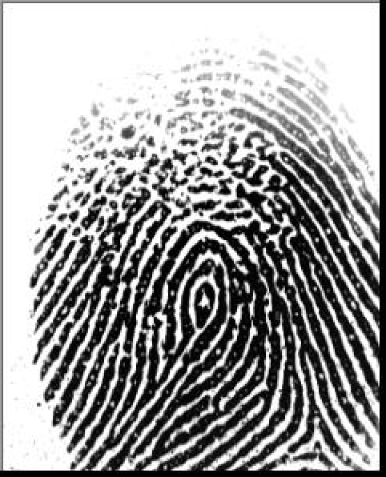 |
| 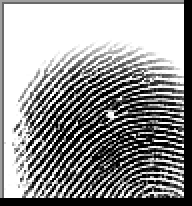 | 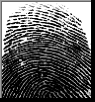 | 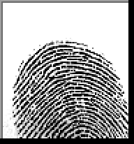 | 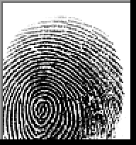 | 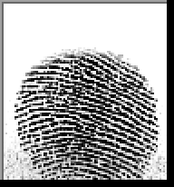 | 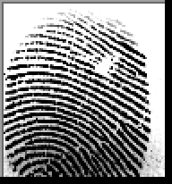 | 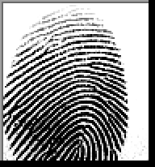 | 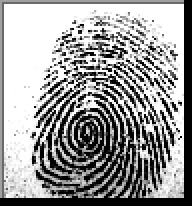 |
| 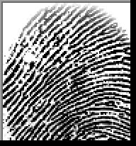 | 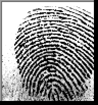 | 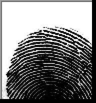 | 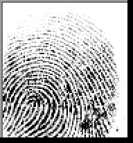 | 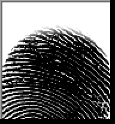 | 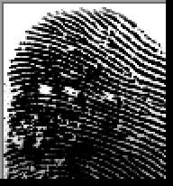 | 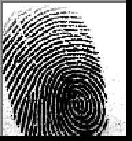 | 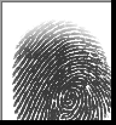 |

All eight groups contain every pattern type. No pattern type belongs to one blood group, which is why the
CNN has to learn subtle statistical texture differences, and why its accuracy must be checked against lab results.
